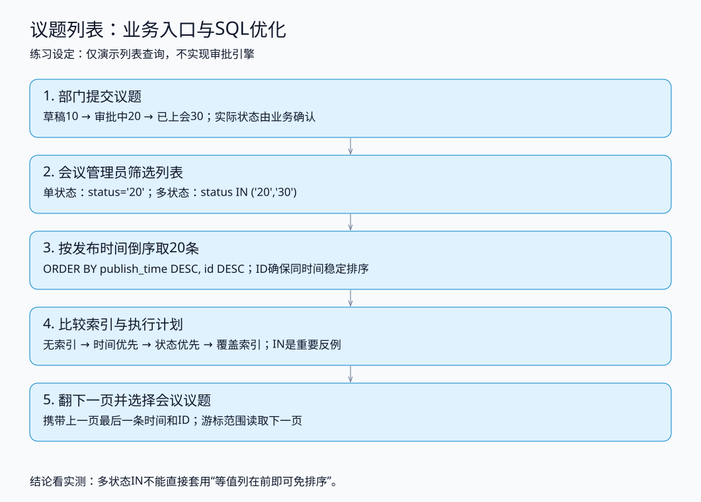

# 议题列表：纯SQL练习Demo

状态：代码与SQL本地验证完成，用户问答尚未判定。属于重新编号后的大纲2。

会议管理员从议题库筛选状态、按发布时间倒序挑选议题。这里模拟查询链路，不实现审批引擎或网页。流程中的状态是练习设定，不作为客户系统已核实事实。



## 环境与运行

复用现有MySQL8容器，无需Spring Boot、Redis或额外数据库服务。独立库`topic_list_lab`，不操作`meeting_lab`。

**01脚本会删除并重建topic_list_lab.meeting_topic，清空这张练习表。** 不要对生产库执行。

推荐在IDEA数据库控制台打开编号SQL，按01→02→03→04顺序逐份运行。03会创建/删除实验索引，重复运行整轮请从01开始。04只依赖03最后保留的idx_cover，可重复执行（每次使用新会话）。

也可以在当前目录执行：

```bash
./run.sh
```

脚本默认连接容器`mysql`，交互输入root密码，不保存密码；可用`MYSQL_CONTAINER`、`MYSQL_USER`覆盖容器与用户。运行日志写入`实测/最近运行/`，不会覆盖本次交付的原始实测。若Docker访问被拒绝，在本人终端执行或反馈具体错误。

## 文件与学习方式

- [分关练习.md](分关练习.md)：先读题、运行、解释计划。
- [sql/练习-TODO.sql](sql/练习-TODO.sql)：关键SQL留给你手写，不必修改标准脚本。
- [标准答案.md](标准答案.md)：独立答案，写完再对照。
- sql/01-schema-data.sql：5万条议题，状态10/20/30，发布时间分布在两年内。
- sql/02-baseline.sql：无二级索引基线。
- sql/03-index-comparison.sql：时间优先、状态优先、IN反例、覆盖索引。
- sql/04-pagination.sql：OFFSET与时间+ID游标对照、一致性校验。
- [练习记录.md](练习记录.md)：AI环境实测，不代表用户已掌握。

只读EXPLAIN看估算；EXPLAIN ANALYZE会实际执行SELECT，用actual rows/time看实际工作量。一次耗时受缓存、系统负载影响，不代表生产指标。
