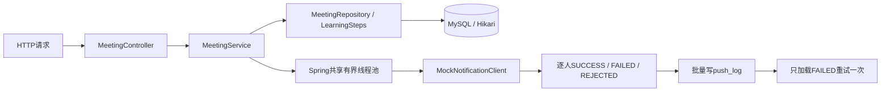

# 大纲四 · 会议通知 Spring Boot 项目

这是可独立导入IDEA、启动内嵌Tomcat、调用HTTP接口的**完整Spring Boot Maven项目**。Controller → Service → Repository/JdbcTemplate → MySQL，Hikari连接池、事务、共享通知线程池和统一异常返回都已搭好。不需要Redis。

你只需要补 `PracticeSteps` 中7个核心方法。默认练习版即使没填TODO也能启动；调用相应接口时返回HTTP501及TODO编号。完整代码答案以 `answer` profile 单独切换，不覆盖你的练习代码。

先读 [动手练习.md](动手练习.md)。接口可用 [requests.http](requests.http) 在IDEA逐条运行，也可按本文用curl。追问见 [关卡与追问.md](关卡与追问.md)，口答参考见 [标准答案.md](标准答案.md)。

## 启动

JDK17+（本机21）、Maven、MySQL8.0.19+（本机8.4）、3306/root；密码不写入仓库。

```bash
cd '/Users/wufeng/Documents/ChatGPT/面试-handoff/coding-lab/mysql-meeting-lab'
./run.sh
# 提示后隐藏输入MySQL密码；启动练习版，http://127.0.0.1:8084
```

IDEA：打开本目录pom.xml作为项目，Project SDK选17或21；运行 `MeetingApplication.main`，Run Configuration的环境变量填 `MYSQL_PASSWORD=你的本机密码`。Active profiles填practice（也可留空，默认就是练习实现）。

可配置环境变量：MYSQL_USER默认root；MYSQL_URL默认127.0.0.1:3306/meeting_lab；SERVER_PORT默认8084。Maven不在PATH时run.sh会尝试本机IDEA自带路径，也可设置MVN_BIN。

```bash
curl -s http://127.0.0.1:8084/api/lab
# implementation=PracticeSteps
curl -s http://127.0.0.1:8084/actuator/health
```

启动不会删表或造数。**POST /api/lab/init会重建meeting_lab中的四张练习表**，不是生产接口。初次数据库不存在时，连接选项允许创建独立meeting_lab库；不修改其他库。服务只监听127.0.0.1。

### 参考答案运行

停止练习版再运行，避免端口冲突：

```bash
./run.sh --answer
# implementation=ReferenceSteps
```

或IDEA的Active profiles改为answer。也可以用不同端口同时启动，但两个版本共用数据库，不要同时做重置/写入实验。

## 五关接口

先用练习版完成无需写代码的第1、2关，再逐步补方法。

| 关卡 | 接口 | 要学习的代码 |
|---|---|---|
| 1 造数和慢链路 | POST /api/lab/init；GET /api/meetings/1/attendees；POST /api/meetings/1/notifications/serial | 已提供串行基线，观察9条SQL与300人逐条通知 |
| 2 EXPLAIN | GET /api/lab/explain | 读type/key/rows/Extra，不需开发 |
| 3 索引与批量查询 | POST /api/lab/index；GET /api/meetings/1/attendees?mode=batch | TODO-1、2 |
| 4 线程池与失败隔离 | POST /api/meetings/1/notifications/parallel；POST /api/lab/saturation；GET /api/lab/pool | TODO-3、4、5 |
| 5 日志与锁 | POST /api/lab/log-benchmark；POST /api/lab/locks | TODO-7；锁实验骨架已提供 |
| 失败落表重试 | POST /api/meetings/1/notifications/parallel?injectFailure=true&persist=true；POST /api/meetings/1/retry；GET /api/meetings/1/logs | TODO-6、7，和前面并发逻辑组合 |

通知接口返回逐人结果、success/failed/rejected和elapsedMs。查询接口返回去重people、peopleCount、sqlCount、elapsedMs。串行通知不接受injectFailure=true；故障实验用parallel。persist默认false，练线程池时不依赖尚未补完的日志写入。

串行基线与EXPLAIN可以直接运行：

```bash
curl -s -X POST http://127.0.0.1:8084/api/lab/init
curl -s http://127.0.0.1:8084/api/meetings/1/attendees
curl -s http://127.0.0.1:8084/api/lab/explain
```

init会清除索引；index只能在该基线上执行一次。再次执行会得到数据库重复索引错误，重做整轮需先init。

## 项目结构

```text
pom.xml
src/main/java/com/wufeng/meeting/
  MeetingApplication.java          Spring Boot启动类
  web/                            REST Controller与统一异常处理
  service/                        会议流程、mock上游、数据库实验
  repository/                     串行查询、造数、EXPLAIN、日志统计
  config/NotificationConfig.java  Spring共享线程池，延迟初始化
  model/Models.java               API DTO
  practice/PracticeSteps.java      你要写的7个TODO
  answer/ReferenceSteps.java       相同接口的完整答案
src/main/resources/
  application.yml                 数据源、端口、连接池配置
  sql/01-init.sql                  四表和造数
src/test/java/com/wufeng/meeting/   单元测试、练习版启动测试、MySQL HTTP集成测试
requests.http                     IDEA接口请求清单
```



## 验证

普通测试验证练习版可启动、TODO提示、拒绝策略、失败隔离和请求中断。无需MySQL：

```bash
mvn test
```

真实MySQL+HTTP完整验证，**会重建meeting_lab四张练习表**：

```bash
read -rs MYSQL_PASSWORD; export MYSQL_PASSWORD; echo
MEETING_MYSQL_TEST=true mvn test
```

项目可 `mvn package` 打可执行jar，`java -jar target/mysql-meeting-lab-1.0.0.jar` 启动。默认练习源码未完成，因此MySQL完整集成测试显式用answer profile；这不代表你的TODO通过。逐关要以practice profile下你写的代码和输出为准。

## 实验口径

- 5万议题，其他49992个议题各10条参会关系，目标8个议题各40条且重叠20人：关系共500240、目标320关系、去重300人。
- 查询无索引逐查→有索引逐查→有索引IN，含共同入口的SELECT计数9→9→2。不凑“几十条SQL”；rows按实测，目标单查约40条，不套用“个位数”。meeting_topic入口查询未加meeting_id索引，双方有相同固定成本。
- 七参数实验起点8/8/30/SECONDS/容量512/命名线程/计数后抛拒绝。共享池统计是应用累计数据。饱和用独立1线程1队列和门闩确定性复现20中2成功18拒绝，不污染共享池统计。
- 20ms是mock等待值，不是真实HTTP超时；取消不保证远端操作停止。真实客户端连接/读取超时需独立配置。此demo没有HTTP响应时间预算保证。
- 283成功/17失败，失败落表后只重试17条一次。没有无限重试或后台定时扫描。唯一日志不等于外部发送幂等，生产还要渠道幂等键/回执与补偿核对。
- 批量用每100条真正多VALUES语句、每批一个TransactionTemplate事务；每批失败回滚，之前已提交批次保留。共享JdbcTemplate/Hikari负责借还连接。日志实验三轮对比单条300SQL/300事务、8线程仍300SQL/300事务、批量3SQL/3事务。
- 死锁实验只对meeting_id99的两条练习日志反序加锁，捕获一次1213并回滚牺牲事务，返回LATEST DETECTED DEADLOCK摘录。诊断时需要相应权限及innodb_deadlock_detect开启；未宣称已完成生产重试调度。
- 初始化、索引、日志压测、死锁实验请串行运行，不要并发重置。所有指标是本地实验数据，不写入客户生产成果。本轮只练大纲四。

## 没有MySQL时

已有MySQL正常则不必再起容器。备用compose监听3308：

```bash
read -rs MYSQL_PASSWORD; export MYSQL_PASSWORD; echo
/usr/local/bin/docker compose up -d mysql
/usr/local/bin/docker compose logs --tail=30 mysql
export MYSQL_URL='jdbc:mysql://127.0.0.1:3308/meeting_lab?createDatabaseIfNotExist=true&useSSL=false&allowPublicKeyRetrieval=true&serverTimezone=Asia/Shanghai'
./run.sh
```

本机连接选项供练习使用，不是生产TLS配置。Docker或MySQL连接不通请贴服务端报错；API对未完成节点返回501，对连接/SQL错误返回500，详细原因在启动终端日志。
