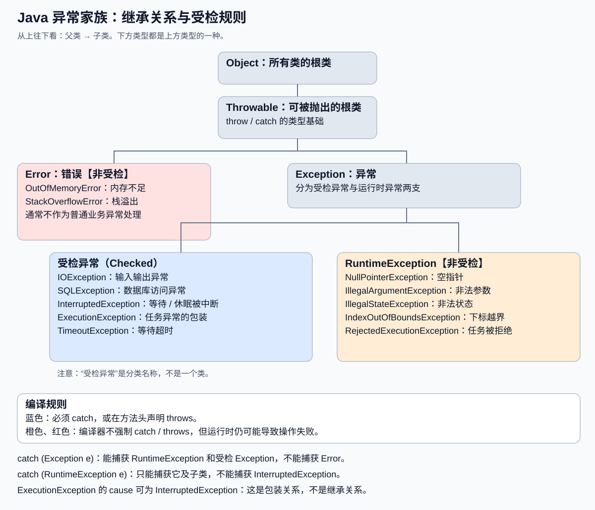
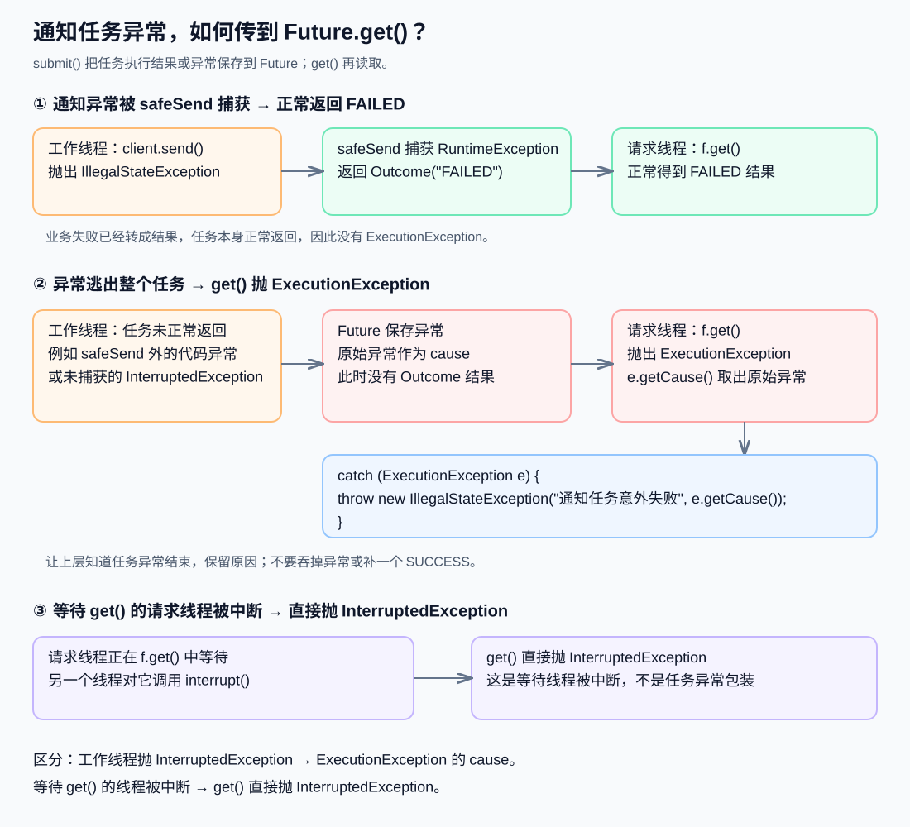
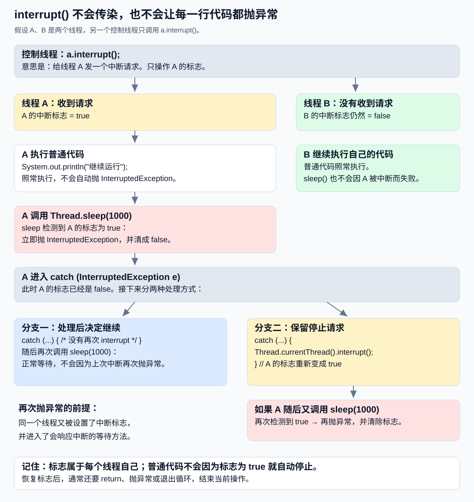
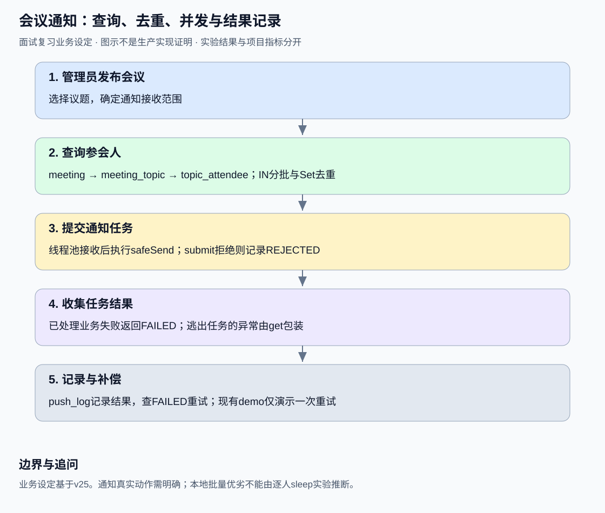
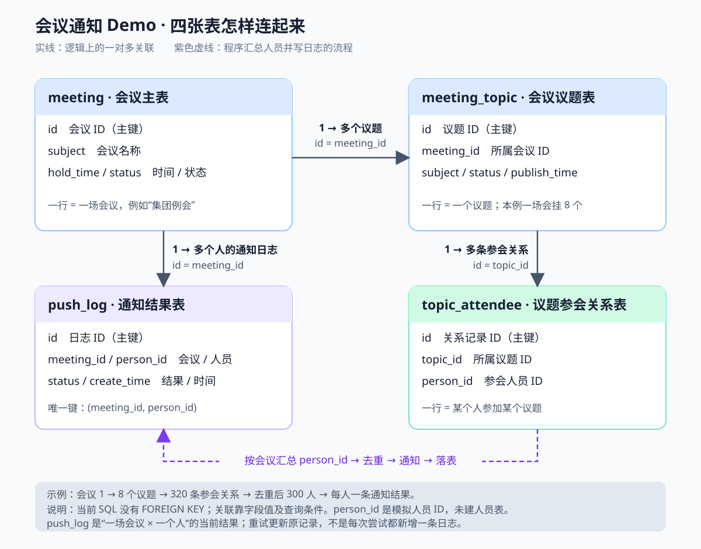
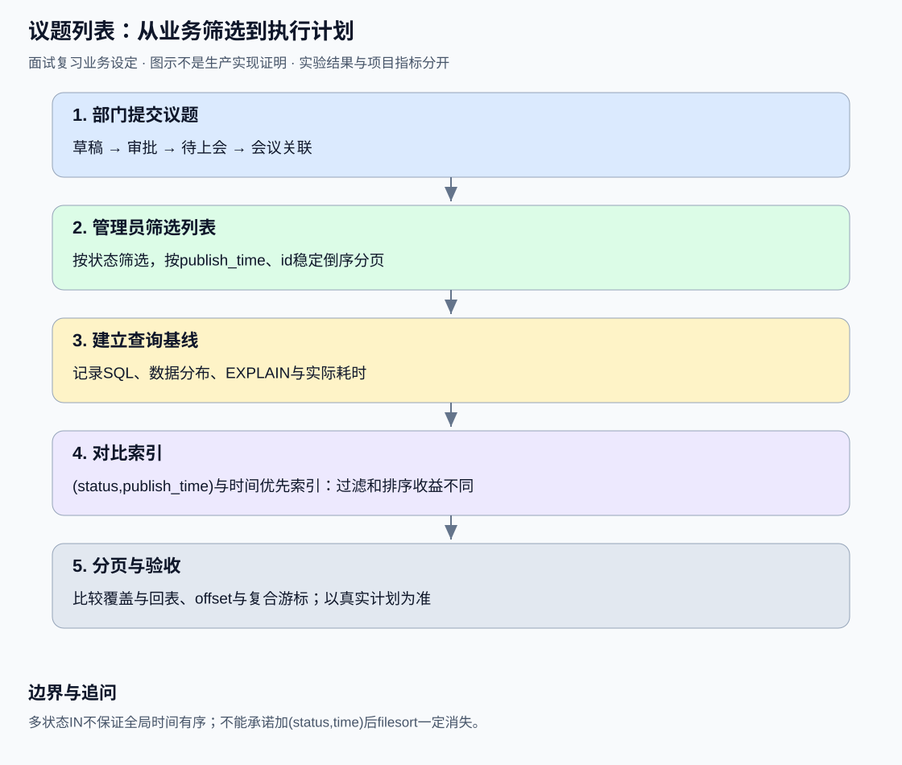
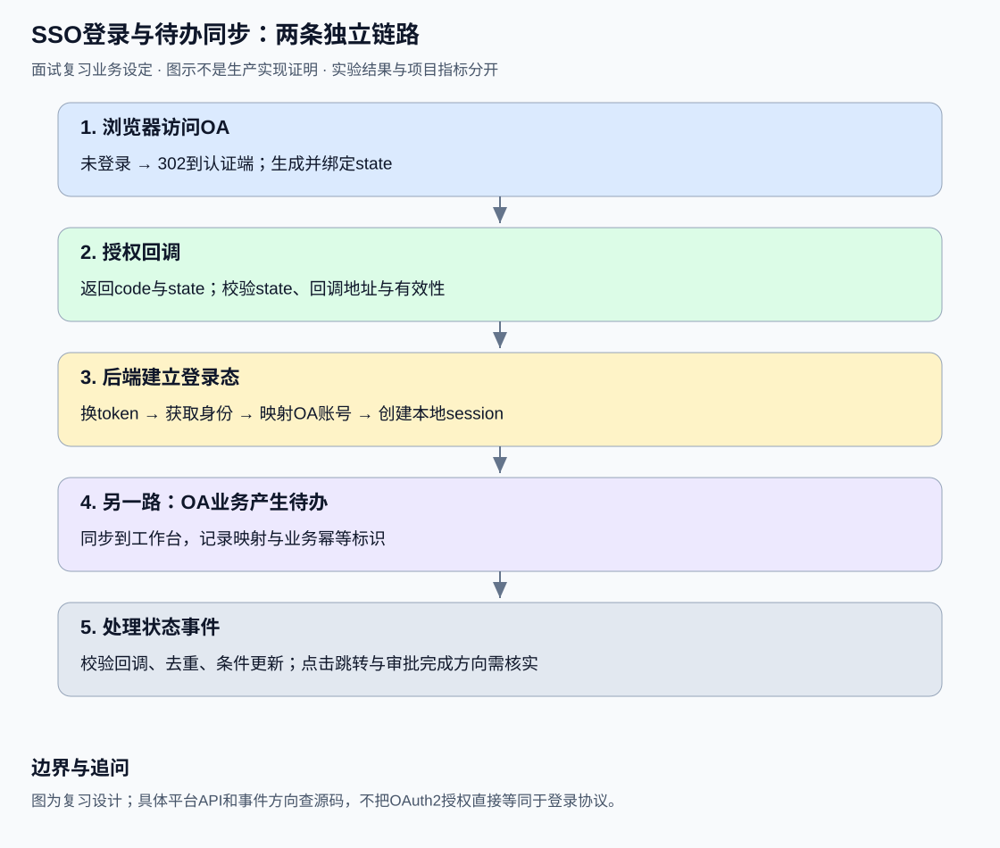
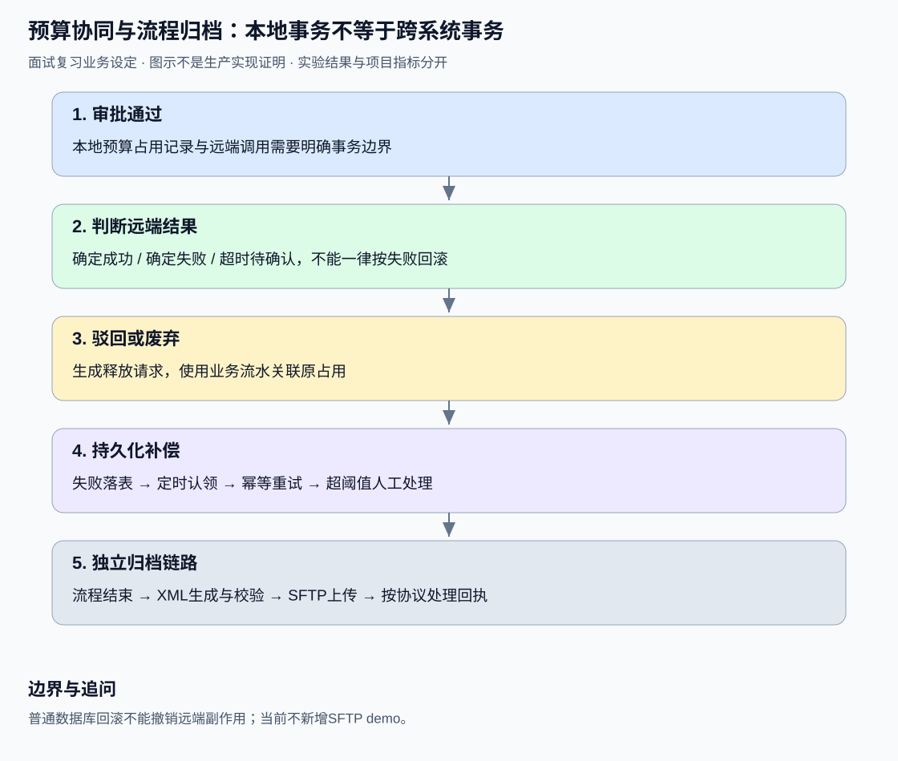
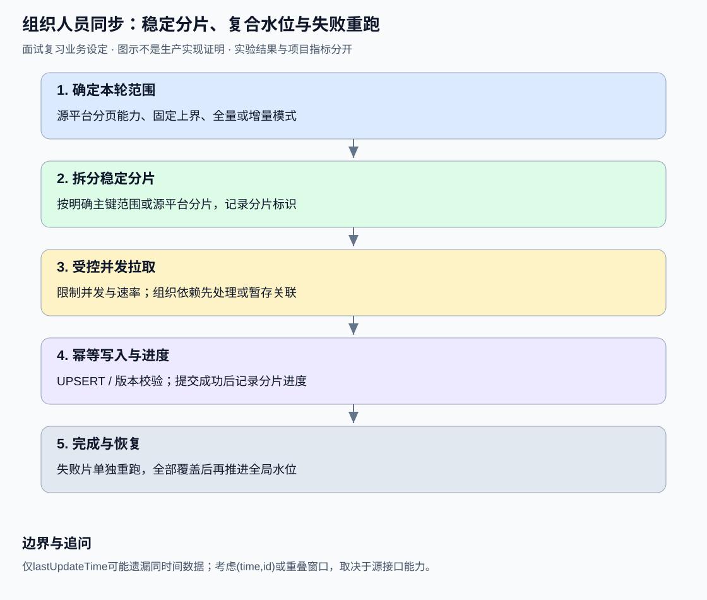
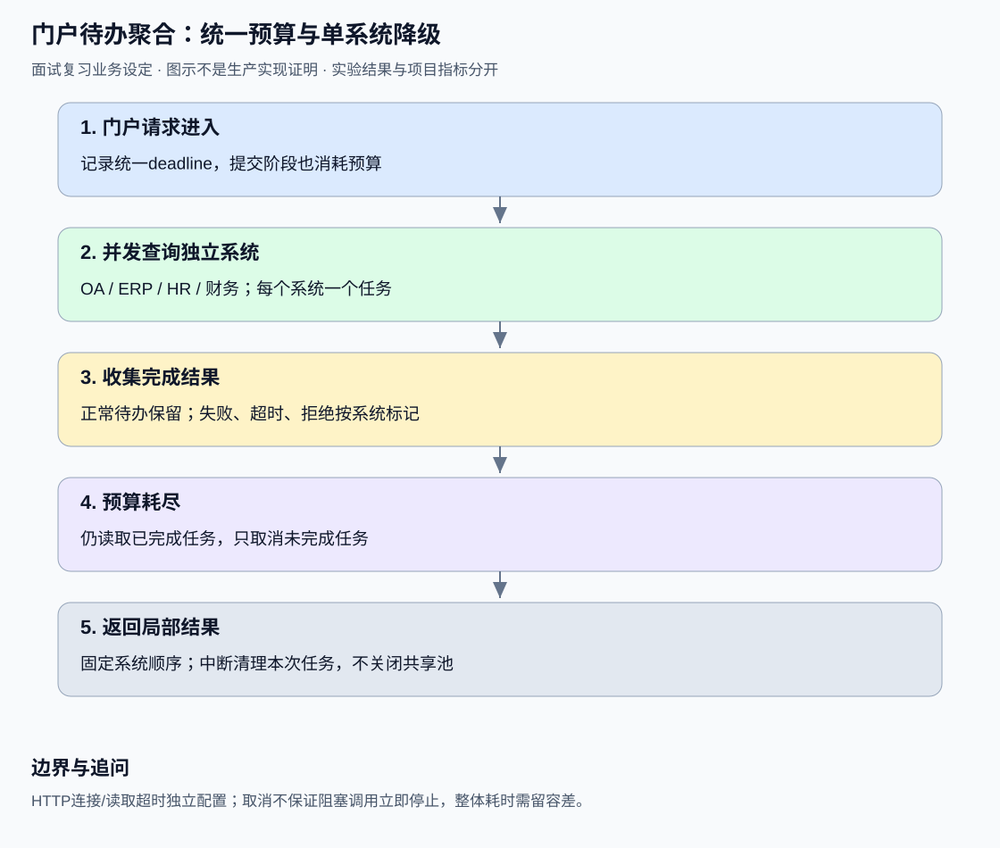

# 面试前复习

当前简历：v25。更新：2026-10-14。本文件是持续维护入口，面向 Java 后端中小公司 / 外包面试，不包含算法刷题。

使用方法：先看业务图，合上图讲一遍；再回答 Q，最后展开 A 对照。每次练习只问一题。本文的答案是复习参考，不代表已经掌握。

“业务设定”是为技术复盘设计的场景；“demo 实现”以仓库代码为准；生产数据、实际接口和真实项目配置交 Windows 源码机核实。实验耗时不写成生产收益。当前会议条目沿用 v25，不采用已撤回的 v26 统一数据平台接口设定，也不预设本地批量比逐人并发慢。

## 目录与复习顺序

1. [八股速答](#八股速答)：Java 集合 → 并发 → MySQL → Spring → Redis → JVM → HTTP。
2. [会议通知](#场景一会议通知)：当前优先练习；完整异常与中断路径。
3. [议题列表](#场景二议题列表)：联合索引与分页，待后续 demo 验证。
4. [SSO 与待办集成](#场景三sso-与待办集成)：授权码、账号映射、回调、幂等。
5. [预算与归档](#场景四预算与归档)：跨系统一致性、补偿、SFTP。
6. [人员同步](#场景五组织与人员同步)：增量、分片、断点和重试。
7. [待办聚合](#场景六门户待办聚合)：最后练；统一预算与局部降级。
8. [练习记录与维护](#练习记录与维护)。

## 八股速答

### Java 基础与集合

| 问题 | 口答要点 | 易错点 |
|---|---|---|
| equals 与 hashCode | equals 相等则 hashCode 必须相等；hash 相同仍要 equals 判断 | 不能用 hash 相同代替相等 |
| HashMap put | 扰动 hash → `(n-1)&hash` 定位桶 → 比较 hash/equals → 覆盖或新增 → 必要时树化/扩容 | 线程不安全，JDK8 尾插不等于并发安全 |
| 扰动与扩容 | `h^(h>>>16)`；容量为 2 的幂；扩容迁移到原位置或原位置加旧容量 | 使用 `(hash & oldCap)` 判断，不是与旧下标 |
| 树化条件 | 链表长度达到阈值时尝试树化，表容量不足 64 则优先扩容；插入计数有边界细节 | 删除后的退化与树形也有关，不能把所有路径都背成固定“小于6” |
| CHM | JDK8 常见路径为空桶 CAS、非空桶同步、协助扩容；禁止 null 键值 | 单次方法安全不等于 get 后 put 的复合逻辑安全，使用 compute/putIfAbsent |
| Set 怎么选 | HashSet 去重无顺序保证；LinkedHashSet 保留插入顺序；TreeSet 按比较规则排序去重 | SQL 未 ORDER BY，不保证查询原始顺序 |
| ArrayList | 动态数组，随机访问快；中间插删需移动元素 | 非线程安全；不能因为用线程池就把所有集合换并发集合 |
| 受检异常 | RuntimeException 和 Error 以外的 Throwable 类型受编译检查，必须捕获或声明 | “运行时异常”是分类名称，不是说其他异常不在运行时发生 |

### 线程池与并发

| 问题 | 口答要点 |
|---|---|
| 七参数 | core、max、keepAliveTime、时间单位、工作队列、线程工厂、拒绝处理器 |
| 提交顺序 | 核心线程不足则创建；否则尝试入队；入队失败尝试创建非核心；再失败则拒绝；关闭状态也会拒绝 |
| 有界 / 无界 | 有界限制积压但要处理拒绝；近似无界队列可能积压耗尽内存，通常也使 max 难以发挥作用 |
| core=max | 固定并发上限，适合明确保护下游资源的场景；不是所有业务都要非核心“救急线程” |
| 30 秒是什么 | 本例为多余空闲线程的存活时间，默认不限制核心线程；不是任务超时 |
| 四种拒绝策略 | Abort 抛异常；CallerRuns 由提交者执行，关闭时不执行；Discard 丢新任务；DiscardOldest 通常丢队头再尝试，关闭时不执行 |
| 为什么自定义拒绝 | 计数后抛异常，提交者记录 REJECTED；不让 HTTP 请求线程执行上游任务 |
| 线程数怎么估算 | CPU / IO 类型是起点；结合下游 QPS、延迟、连接池、CPU和压测调节。IO 线程数不固定等于 2N |
| submit / execute | submit 返回 Future，通常用 FutureTask 保存任务异常；execute 的未捕获异常会沿工作线程未捕获异常路径处理 |
| Runnable / Callable | run 无结果且不声明受检异常；call 返回结果且允许 throws Exception；Lambda 受目标接口约束 |
| get / get(timeout) | 前者无等待上限；后者到时抛 TimeoutException，不自动取消；逐个等3秒不等于整体3秒 |
| shutdown / shutdownNow | 前者不接新任务、处理已接收任务；后者尝试中断并返回尚未启动任务；都不保证任务立即停止 |
| CountDownLatch | await 等计数归零，countDown 减一；定时 await 到时 false、归零 true；普通 await 无返回值；一次性 |
| AtomicInteger | CAS 等机制保证单次增量原子性；incrementAndGet 加1返回新值，getAndIncrement 返回旧值，addAndGet 可加任意增量 |
| volatile | 可见性与有序性保障，不保证 i++ 原子性 |
| synchronized / Lock | synchronized 自动释放；ReentrantLock 支持可中断、超时、公平与多个 Condition，finally unlock |
| ThreadLocal | 数据随线程隔离；线程池复用要 finally remove，避免跨请求残留和泄漏 |

### 异常与中断必背

- `FAILED` 是 Outcome 的业务状态，不是异常。safeSend 捕获 RuntimeException 并返回 FAILED，get 正常拿到结果。
- 任务未处理异常逃出 Callable：get 抛 ExecutionException，原始原因用 getCause。
- 当前请求线程等待 get 时被中断：get 直接抛 InterruptedException。
- `catch` 只匹配直接抛出的类型，不会自动拆 cause；ExecutionException 与 InterruptedException 不是父子类。
- `throw cause` 的声明类型是 Throwable，可能受检，不能在只声明 InterruptedException 的方法随意向外抛。
- `interrupt()` 设置目标线程标志，不强制终止普通计算。sleep/await/get 响应中断时清除标志并抛异常，catch 本身不清除。
- 恢复中断标志是在当前线程调用 interrupt，保留停止请求供后续代码检查；不会主动通知上层，也不会自动退出。
- 直接向外抛 InterruptedException 通常可以由上层处理；捕获后吞掉或转换异常时通常应恢复标志。当前 demo 同时恢复并再抛是其约定。
- `cancel(true)` 尝试中断执行任务的工作线程，本身不抛 InterruptedException；成功取消不代表工作已经停止。
- `purge()` 清除池队列中已取消的任务，不关闭池、不撤回外部副作用、不停止运行中任务。

### MySQL

| 问题 | 口答要点 |
|---|---|
| 聚簇 / 二级索引 | InnoDB 聚簇叶子存行；普通二级索引叶子存索引列和主键；查询其他列通常回表 |
| EXPLAIN 怎么看 | SQL 条件与排序 → type → key/possible_keys → rows/filtered → Extra，结合真实执行与统计信息 |
| type | ref 常见于非唯一等值；range 为区间/IN 等范围访问；index 为索引全扫；ALL 为表全扫；不能只按档位判断耗时 |
| rows / filtered | rows 估算扫描量；filtered 是过滤后保留比例估算。499086×10%不是实测，也不是实际读取了表的10% |
| Extra | Using index 通常覆盖；Using index condition 为索引条件下推；Using filesort 为额外排序，不必然落盘；temporary 不必然磁盘临时表 |
| 覆盖索引 | 查询需要的列已在索引中，避免回表；代价是空间、写维护和缓存占用 |
| ICP | 存储引擎利用索引可判断的条件，在取完整行前筛选。出现标记不代表本次一定显著少回表 |
| 最左前缀 | 联合索引按列顺序组织；等值、范围、排序组合决定使用程度，不能机械说“范围后所有列都失效” |
| 聚合能用索引吗 | 能；COUNT/MIN/MAX/GROUP BY 等是否获益看 SQL、索引、过滤和计划，聚合不等于索引失效 |
| 事务隔离 | RU、RC、RR、Serializable；InnoDB 常见默认 RR，实际以环境配置为准；区分快照读与当前读 |
| MVCC | Read View、事务信息、undo 版本链支持一致性读；不是所有读都不加锁 |
| 死锁 | 捕获错误、回滚受害事务，查看 InnoDB 状态/锁信息；统一访问顺序、缩小事务、索引减少锁范围、有限重试 |

### Spring

| 问题 | 口答要点 |
|---|---|
| IoC 与单例 | 容器管理对象和依赖；单例通常每容器每 Bean 一份，不是 static，也不自动线程安全 |
| @Bean 参数 | 方法参数由容器解析注入；默认 Bean 名为方法名，通常按类型查找，多候选用 Qualifier/Primary 等消歧 |
| ObjectProvider<T> | 注入的是提供器；getObject 时查找/获取 T，必要时创建。变量不会变成 T |
| @Lazy | 延迟创建 Bean；普通非懒依赖直接需要它时仍可能触发创建；Provider 可推迟获取 |
| destroyMethod | 容器销毁 Bean 时调用指定方法；共享池在容器关闭时 shutdown，不在每次请求结束时关闭 |
| AOP | 代理包裹方法实现横切逻辑；JDK代理与类代理有不同限制，不凭“有接口”断言实际代理方式 |
| 事务边界 | 代理调用、方法可见性、异常回滚规则、自调用、传播行为都影响事务；不能绝对说所有非 public 都失效 |
| 线程与事务 | 命令式事务通常绑定当前线程；父线程事务不会自动传播到池线程；异步任务需独立明确事务 |
| 异常与回滚 | 默认 RuntimeException/Error 通常回滚；受检异常需要相应 rollbackFor；吞异常可能导致提交 |
| 自动配置 | 条件装配选择配置，结合依赖、属性和已有 Bean；不是“扫描到所有配置无条件创建” |

### Redis、JVM、HTTP

| 主题 | 口答要点 |
|---|---|
| 缓存三问题 | 穿透：不存在数据反复查库；击穿：热点失效重建竞争；雪崩：大量失效或整体不可用；分别考虑空值/布隆、互斥重建、TTL打散/降级 |
| 缓存一致性 | 常见 Cache Aside 先更新库再删缓存；仍有并发和删除失败窗口，需补偿与业务容忍，不宣称强一致 |
| Redis 锁 | 唯一 value、SET NX 与过期、原子校验再删除；过期可能导致并发持有，关键业务还需幂等/版本或 fencing 等保障 |
| 幂等 | 相同业务请求重复到达只产生一次有效业务结果；唯一约束/状态转换/幂等键，不等同“先查再插” |
| JVM 区域 | 栈/PC等线程私有，堆/方法区共享；元空间为常见方法区实现。分代布局取决于收集器，别把8:1:1当所有JVM固定结构 |
| GC | 可达性与GC Roots；G1 Region及停顿目标，目标不是响应保证；OOM区分堆、元空间、直接内存和线程资源等 |
| 排障 | CPU高看热点线程栈，内存看监控/GC/堆转储；先保留现场，再验证假设，不只背工具名 |
| HTTP 超时 | 连接、读取、连接池获取与整体业务预算不是同一个计时器；超时不证明对方未成功 |
| 重试 | 只重试可恢复故障，限制次数、退避、幂等；业务参数错误不盲重试 |
| OAuth2 / 登录 | OAuth2主要用于授权；登录还要通过用户信息接口或OIDC等确认身份，token不当然等于本系统会话 |

## 场景一：会议通知

### 简历口径与业务设定

v25 原文：改造会议通知功能，单场会议参会人可达上百人，改为线程池并发下发通知（有界队列 + 拒绝策略 + 单条失败隔离重试），替代原串行逐个推送。

业务设定：管理员选议题发布会议，按议题查人、合并去重、执行通知、记录结果、补偿失败。这里不补“统一数据平台只支持单人接口”的已撤回设定。具体通知动作是本地写表还是外部调用仍需明确；线程池 demo 只能说明串行逐人和并行逐人的差异，不能证明批量本地写入更慢。

### 技术落点与 demo 边界

| 环节 | 技术点 | 当前状态 |
|---|---|---|
| 查议题与人员 | topic_id 索引、分批 IN、Set去重、SQL计数 | 已有实现；本人 TODO 验收另记 |
| 并发通知 | 手写7参数、命名线程、有界队列、拒绝计数 | 已有模拟；safeSend 内 sleep20ms，无真实HTTP |
| 结果隔离 | SUCCESS/FAILED/REJECTED、Future收集 | 已有实现，意外异常采用整体退出清理 |
| 结果落库 | push_log 每100条、多VALUES、每批事务、唯一键 | 有标准答案；push_log 是记录，不是实际待办表 |
| 失败补偿 | 查 FAILED，重试一次模拟接口 | 已有演示；不是持久调度器、不是可靠消息系统 |
| 饱和实验 | 1线程+1队列，Latch卡住首任务 | 20个提交：2接收、18拒绝；专用池结束关闭 |

实测样本：用户贴出的并行响应为300条，283成功、17失败、0拒绝、约850.66ms；故障条件为首次尝试且personId能被17整除。仅是一次实验，不是生产指标或稳定SLA。索引后样本：单查 ref/rows40，批查 range/rows320；rows为估计。

### 追问 Q&A

M01 为什么线程池而不是直接批量插入？

先明确慢的是哪个动作。如果纯本地待办写入，应先比较批量写入、事务与索引优化；独立耗时调用才有并发依据。不能凭逐人sleep实验声称线程池优于本地批量。面试前需确定通知真实调用链和对照基线。

M02 索引与批量 IN 分别解决什么？

索引减少每次检索扫描量；IN减少SQL次数与网络往返。本例8个议题，查议题1次+逐议题查人8次=9；500以内合并后1+1=2。500是输入ID分块，不是LIMIT分页，查询可返回多于500行。

M03 为什么单查 ref 和 IN range 都要回表？

idx_topic只有topic_id和主键，没有person_id，读取person_id通常要回表。IN显示Using index condition时，本例JSON里的index_condition就是IN条件；不能凭标记声称额外过滤很多行。加(topic_id,person_id)可考虑覆盖，需评估写成本。

M04 拒绝异常在哪里捕获？

在submit外捕获。池满时任务没被接收，Lambda根本不执行；放在safeSend周围抓不到提交拒绝。记录该人员REJECTED，继续其他提交。

M05 FAILED 为什么不会触发 ExecutionException？

safeSend已捕获RuntimeException，返回FAILED对象，任务正常完成。只有异常逃出整个任务，get才以ExecutionException包装；getCause取原始原因。

M06 意外任务异常之后循环与 return 还执行吗？

当前策略在ExecutionException catch包装IllegalStateException，外层RuntimeException catch取消任务、purge并再抛。循环退出，return不执行。若选择局部降级，应记录人员ID、补失败结果并保留日志；不能空catch导致结果消失。

M07 两种 InterruptedException 怎么区分？

任务内抛出的未处理中断，经get表现为ExecutionException的cause（Future被取消则可能是CancellationException）；等待get的请求线程被中断，直接抛InterruptedException。恢复的是当前请求线程的标志，不因工作线程cause中断就误恢复请求线程标志。

M08 取消后已经发出去的通知怎么办？

不能撤回。未开始任务可取消，运行中只是尝试中断，副作用可能已发生。若要求受理后必须送达，应持久化任务再由后台执行、记录状态和补偿；不能依赖HTTP请求存活保证送达。当前demo未完整实现该机制。

M09 为什么不能请求结束时 shutdown？

共享Bean被多个请求使用，关闭后无法重新启动，后续submit被拒绝；只清理本次Future。饱和实验临时专用池是另一回事，可以finally关闭。

M10 日志唯一键为什么不是生产幂等的全部？

meeting_id/person_id只保证本地记录唯一，不能阻止外部已成功但响应丢失后的重复副作用。需要业务事件/版本/接收人等幂等键及下游协同。同一会议重新发布是否允许再通知也要定义。

M11 数据库一批失败会影响前面成功批次吗？

标准答案每100条一个独立事务；当前批回滚，之前已提交的批次不会自动回滚。多线程也不会天然解决事务隔离，事务边界必须明确。

M12 如何确定8线程、512队列合适？

它们是实验参数，不是生产最优值。测单调用延迟、峰值到达率、下游容量、连接数和排队时间；用拒绝率与延迟约束压测调节。队列大只延后拒绝，也可能放大等待。

代码与练习：[demo README](coding-lab/mysql-meeting-lab/README.md)、[动手题](coding-lab/mysql-meeting-lab/动手练习.md)、[标准答案](coding-lab/mysql-meeting-lab/标准答案.md)、[练习记录](coding-lab/mysql-meeting-lab/练习记录.md)。

## 场景二：议题列表

设定：管理员按审批状态与发布时间筛选议题，稳定倒序分页。关键SQL为状态过滤、时间排序、LIMIT。

技术点：B+树、最左前缀、等值与范围、覆盖/回表、filesort、排序稳定性、深分页。

T01 (status,publish_time) 一定消除排序吗？

不一定。单status等值时更容易借后续时间顺序；status IN多个值时，各状态内时间有序不等于全体时间有序，可能仍filesort。原大纲对此过度承诺，复习以真实计划为准；与(publish_time,status)比较扫描/过滤代价。

T02 深分页怎么处理？

固定排序publish_time DESC,id DESC，下一页用时间与ID组成游标：publish_time小于上次时间，或时间相同且id更小。只用id游标不一定保持按时间排序语义；需要结合索引实测。普通LIMIT offset大时可能读取丢弃大量行。

T03 为什么不能 SELECT * 后说覆盖？

覆盖取决于实际查询列。加subject等宽字段会增大索引，是否值得以读写负载衡量。先缩小投影列，比较rows、耗时、回表与空间。

状态：业务设计与Q&A已整理，未因本文件而新增或验收大纲五demo。

## 场景三：SSO 与待办集成

设定：OA接入统一身份认证；OA业务待办与钉钉工作台集成。身份登录与待办同步是不同链路。

技术点：过滤器、302、授权码、state、token、用户身份、账号映射、本地会话、回调验签、幂等状态机。具体钉钉API方向与事件类型需核实，不能把“点击跳转OA办理”和“在钉钉原生完成审批”混为一谈。

S01 code、token、session 有什么不同？

code为短期一次性授权凭证；后端向认证端换token，用于访问受保护资源；本地session代表OA自身登录态。拿到token后还需可靠获取用户身份并映射本地账号。

S02 state、回调白名单、一次性票据分别保护什么？

state与登录发起会话绑定并验证，防登录CSRF/串号；回调白名单约束重定向目标；一次性凭证消费与有效期限制减少重放。不能只生成state而不验证。

S03 回调来了两遍，或者完成事件早于创建结果怎么办？

以业务ID/事件ID去重，事务内条件更新状态，定义合法状态转换与事件顺序/版本；不能让较旧事件把已完成状态改回待处理。验签、时间窗和来源身份校验先于业务更新。

S04 一个幂等键能解决什么？

需明确键覆盖的业务事件，例如审批实例+节点任务+接收人+目标系统；DB唯一约束并发兜底。先查再插有竞争；只本地去重不自动解决远端超时后的不确定结果。

补充：[SSO讲义](SSO单点登录-原理与面试话术.md)。

## 场景四：预算与归档

设定：审批通过占用预算，驳回/废弃触发释放；流程结束生成XML并SFTP归档。保留简历措辞，但复习时需识别“本地回滚无法回滚外部系统”的边界。

技术点：本地事务、跨系统不确定状态、补偿表、幂等、重试退避、人工处理、XML校验、文件命名、SFTP认证与超时。

B01 推送失败回滚本地占用就一致了吗？

只在远端确定未处理时才容易对应；超时可能远端已成功，直接回滚本地会不一致。需按业务流水查询远端、记录待确认状态、幂等重试或补偿，普通@Transactional不覆盖HTTP副作用。

B02 定时补偿怎么防多节点重复处理？

持久化状态、尝试次数、下次执行时间；条件更新认领或带过期的租约，限制批量/并发；下游业务幂等兜底。认领成功但进程崩溃需要超时恢复；重试超阈值人工处理。

B03 XML上传成功是否等于业务归档成功？

不一定。上传、对方解析、业务入账/归档可能是不同状态；校验文件完整性、约定临时名上传后改名，按协议处理回执与重复文件。真实SFTP工具能力查源码，不假定全部已实现。

本轮不新建SFTP demo，仅维护复习口答。

## 场景五：组织与人员同步

设定：主数据平台维护组织人员，OA分页拉取，全量初始化按稳定边界分片并发，增量使用更新时间与稳定ID水位。

技术点：稳定分页、复合水位、快照边界、幂等UPSERT、依赖顺序、分片进度、限流、失败重跑。

O01 只记 lastUpdateTime 会漏数据吗？

相同更新时间多行、同步期间持续更新可能导致遗漏。用(updateTime,id)游标与固定本轮上界，或重叠时间窗+幂等；具体方案取决于源接口排序/快照能力。删除需删除标记或独立事件。

O02 一个分片失败怎么办？

记录分片范围和已提交进度，只重跑该片；用稳定主键UPSERT去重。不能因为其中几片完成就推进全局水位到所有数据之后；全局完成状态要覆盖全部分片。

O03 部门与人员乱序怎么办？

先同步组织或暂存待关联人员，约定孤儿数据处理；并发数同时受源平台限流和本地DB容量限制，并非越多越快。

状态：复习设计已整理，未新增demo。

## 场景六：门户待办聚合

设定：门户首页分别查询OA、ERP、HR、财务待办，各来源独立调用；整体预算从聚合入口开始，正常来源结果尽量保留。

技术点：并发IO、统一deadline、提交拒绝、系统级降级、连接/读取超时、取消清理、缓存降级选择。

P01 每个Future等250ms就是整页250ms吗？

不是。入口记录单调时间deadline，提交与等待都消耗预算。等待前计算remaining；预算用完仍读取已完成任务，仅取消未完成任务。调度、清理、序列化等有开销，测试需容差，不保证绝对250ms响应。

P02 前面任务慢、后面已完成怎么办？

不能超时后立即丢掉所有后续结果；检查已完成状态并读取结果。可用CompletionService按完成顺序收集，但也要处理异常、拒绝、截止时间和稳定输出排序。

P03 失败后为什么不取消整个聚合？

首页允许局部结果，单系统异常转为该系统FAILED/TIMEOUT/REJECTED；当前会议demo的意外异常整体退出策略不能原样照搬。请求线程被中断时清理本次任务。

状态：按约定排在大纲四、五之后练；不把旧实验值当作已验收结果。

## 其他真实交付经历的追问准备

| 业务 | 技术点 | 需要能回答的Q / 答案骨架 |
|---|---|---|
| 管理员权限 | 角色、数据范围、后端鉴权 | 只隐藏按钮够吗？不够，接口与数据查询都校验，防越权 |
| 金额逐级校验 | BigDecimal、事务、并发更新 | 前端校验够吗？后端再校验；并发金额变动用版本/锁/原子条件更新按场景选择 |
| Excel导入 | POI、模板、行级错误、批次 | 一行错怎么办？定义整批或部分成功，导入ID幂等，限制文件与内存；真实实现核实 |
| 业务模块联动 | 状态转换、关联键、事务 | 谁是主数据、什么时候更新、跨模块失败怎么办？画出触发点与数据归属 |
| 督办锁冲突 | ORM save/update、事务、锁 | 哪两条SQL竞争、为何改update有效？查Windows源码和日志，不能只背“改DAO解决” |
| 定时任务死循环 | 退出条件、进度、重入 | 具体循环变量/分页条件是什么？核实源码；加最大批次/无进展退出与告警是改进方向 |

## 练习记录与维护

| 主题 | 材料状态 | 口答状态 | 下一步 |
|---|---|---|---|
| 会议通知 | demo、业务SVG、Q&A已整理 | 待逐题判定 | M01开始，一题一答 |
| 异常与中断 | 已整理本次解释 | 待复测 | 不看答案解释两线程异常路径 |
| 议题列表 | SVG、Q&A已整理 | 待练 | 后续大纲五实测 |
| SSO与待办 | SVG、Q&A已整理 | 待练 | 核实具体回调方向 |
| 预算与归档 | SVG、Q&A已整理 | 待练 | 重点讲超时不确定性 |
| 人员同步 | SVG、Q&A已整理 | 待练 | 解释水位不漏数据 |
| 待办聚合 | SVG、Q&A已整理 | 待练 | 最后练demo |

每次维护：先确定简历版本与业务口径，更新对应SVG、技术点、Q&A与易错点；实测附环境/输入/多轮结果，生产指标单独核实。修改场景假设时保留变更记录，不静默替换成“已经做过”。不自动推送GitHub。

逐题判定模板：

| 子问题 | 我的回答 | 判定 | 正确说法 |
|---|---|---|---|
| 本轮实际提问 | 填本人原答 | 对 / 不完整 / 错 | 判定后补 |
| 汇总 | 对 X / 不完整 Y / 错 Z | 这题要不要再练 | 给出下一步 |

2026-10-14：建立首版；依据v25，汇总六个业务流程图及技术点、八股与追问；全部练习状态保留待判定。会议场景不采用v26已撤回的外部单人HTTP接口设定。

## 2026-10-14进度更新

会议通知本轮已完成（本人确认，非逐题自动判定）。Demo改从1编号：1会议通知、2议题列表；待办聚合不再安排新Demo。议题列表纯SQL练习见[coding-lab/mysql-index-lab/topic-list/README.md](coding-lab/mysql-index-lab/topic-list/README.md)，包括状态IN反例、覆盖索引、时间+ID游标与独立追问答案。
